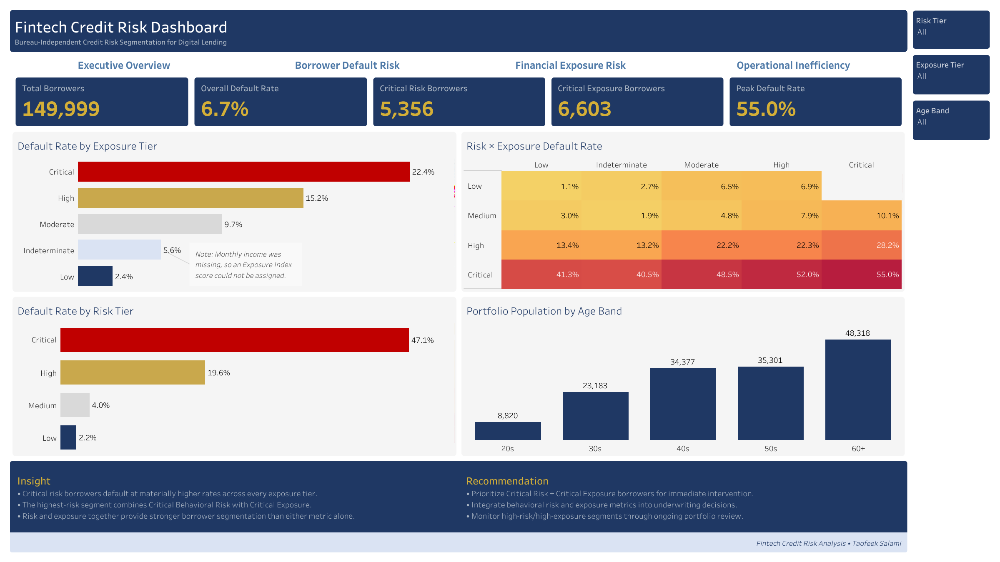
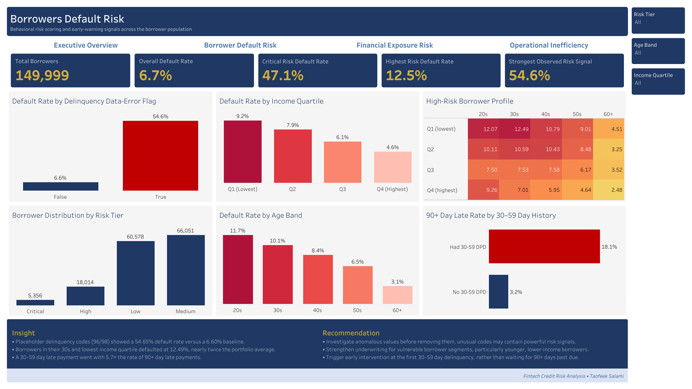
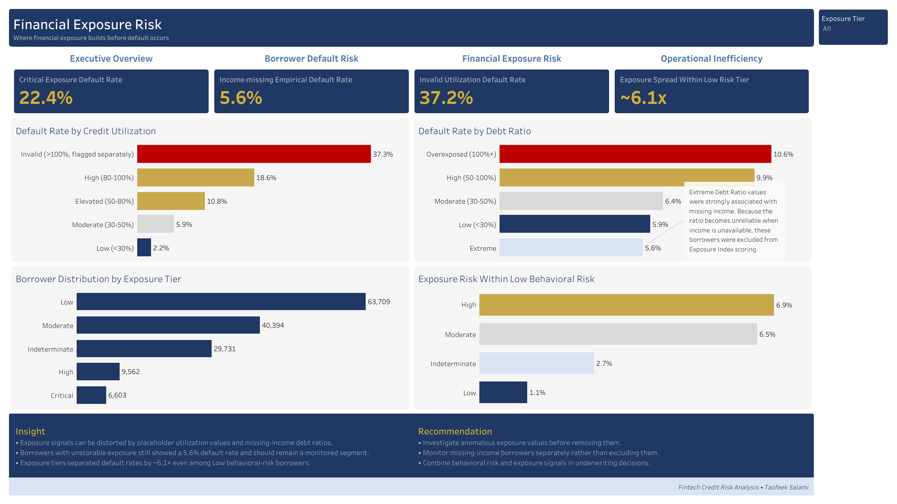
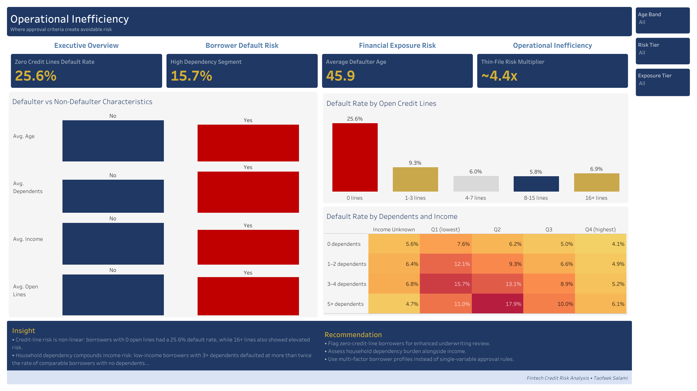

# Fintech Credit Risk Analysis
### Bureau-Independent Credit Risk Segmentation for Digital Lending



---

## Problem Statement

Nigeria's digital lending industry has grown rapidly, expanding access to credit for a population historically underserved by traditional banking. However, this growth has been accompanied by increasing credit risk, while many borrowers remain outside the coverage of traditional credit bureaus.

As a result, digital lenders increasingly rely on alternative behavioral signals—including repayment history, credit utilization, debt burden, income characteristics, and borrower profiles—to assess credit risk.

This project develops a bureau-independent credit risk segmentation framework using the public **Give Me Some Credit** dataset as a proof of concept.

Although the dataset originates from the United States, its behavioral credit variables closely resemble alternative lending signals commonly used by digital lenders when traditional credit bureau information is limited or unavailable.

The project demonstrates how SQL, Python, and Tableau can be combined to transform raw lending data into actionable business intelligence for:
- Borrower default risk segmentation
- Financial exposure assessment
- Operational risk analysis
- Evidence-based underwriting decisions

---

## Executive Summary

This project presents an end-to-end credit risk analytics solution covering the complete analytical workflow—from database design and ETL through data quality assessment, feature engineering, SQL analysis, risk scoring, exposure indexing, business interpretation, and executive reporting.

Using behavioral lending data, the project:
- Identifies borrowers most likely to default.
- Develops a custom **Behavioral Risk Score** for borrower segmentation.
- Builds an **Exposure Index** to estimate relative exposure where direct loan balance and credit-limit data are unavailable.
- Evaluates structural borrower characteristics associated with elevated default risk.
- Investigates data-quality anomalies that may contain meaningful predictive signals.
- Delivers a four-dashboard interactive Tableau reporting application.

The result is a bureau-independent credit risk framework designed to demonstrate how alternative borrower data can support lending decisions in emerging digital credit markets.

The question, scope, metric definitions and known risks are recorded in [PROJECT_INFO.md](PROJECT_INFO.md), written retrospectively in October 2026.

---

# 🖥️ Dashboard Preview

## Executive Overview


Provides a high-level view of portfolio default risk, behavioral risk tiers, financial exposure, and the compounding relationship between borrower risk and exposure.

---

## Borrower Default Risk



Identifies the borrower segments most likely to default and examines behavioral early-warning signals across delinquency history, age, income, and risk tiers.

---

## Financial Exposure Risk



Evaluates relative borrower exposure using credit utilization, debt burden, and the Exposure Index, while examining whether exposure adds predictive value beyond behavioral risk history.

---

## Operational Inefficiency



Examines structural borrower characteristics—including credit line count, income, age, and household dependency—to identify opportunities to strengthen underwriting and improve lending decisions.

---

## Repository Structure

```text
fintech-credit-risk-analysis/
│
├── data/
│   ├── raw/
│   └── processed/
│
├── docs/
│   ├── documentation_index.md
│   ├── phase_00_project_setup.md
│   ├── phase_01_data_cleaning_eda.md
│   ├── phase_02_borrower_default_risk.md
│   ├── phase_03_financial_exposure_risk.md
│   ├── phase_04_operational_inefficiency.md
│   ├── phase_05_dashboard_design_documentation.md
│   ├── phase_06_business_insights_recommendations.md
│   ├── phase_07_inference_prediction.md
│   ├── data_dictionary.md
│   ├── project_glossary.md
│   ├── security_notes.md
│   └── tableau_blueprint.md
│
├── notebooks/
├── outputs/
├── sql/
│
├── tableau/
│   ├── workbook/
│   └── screenshots/
│
├── PROJECT_INFO.md
├── README.md
└── LICENSE
```

---

## Data

| Attribute | Description |
|---|---|
| Source | Kaggle — Give Me Some Credit |
| Original Records | 150,000 borrowers |
| Processed Records | 149,999 borrowers |
| Dataset Type | Consumer Credit Risk |
| Target Variable | Serious delinquency within two years (90+ days past due) |

### Methodological Note

Public Nigerian lending datasets containing borrower-level repayment behavior are limited. Therefore, this project uses the Give Me Some Credit dataset as a bureau-independent proof of concept.

The analysis focuses on behavioral lending patterns—including repayment history, credit utilization, debt burden, income characteristics, and borrower profiles—rather than absolute monetary values.

The methodology is therefore designed to demonstrate a transferable analytical framework rather than claim that the source dataset directly represents the Nigerian lending population.

---

## Business Questions

This project answers three core business questions:

1. Which borrowers are most likely to default, and what are the earliest warning signals?
2. Where does the portfolio show elevated financial exposure risk, and does exposure add predictive value beyond behavioral history?
3. Which borrower characteristics and structural patterns indicate opportunities to improve lending decisions?

---

## Methodology

The project follows a structured analytical workflow:

```text
Phase 0 — Project Setup & Database Design
                    │
                    ▼
Phase 1 — Data Cleaning & Exploratory Analysis
                    │
                    ▼
Phase 2 — Borrower Default Risk Analysis
                    │
                    ▼
Phase 3 — Financial Exposure Risk Analysis
                    │
                    ▼
Phase 4 — Operational Inefficiency Analysis
                    │
                    ▼
Phase 5 — Dashboard Design & Documentation
                    │
                    ▼
Phase 6 — Business Insights & Recommendations
                    │
                    ▼
Phase 7 — Statistical Inference & Predictive Modeling
```

The workflow combines:
- MySQL database design and SQL business analysis
- Python ETL and data cleaning
- Feature engineering and risk scoring
- Behavioral Risk Score development
- Exposure Index construction
- Exploratory and explanatory visualisation
- Interactive Tableau dashboard development
- Evidence-based business recommendations

---

## Key Findings

### Borrower Default Risk

- Borrowers in their 20s (11.73%) and 30s (10.07%) had the highest observed default rates of the five age bands.
- Borrowers with at least one 30–59 day late payment were about 5.7× as likely to also have a 90+ day late payment on record (18.13% against 3.17%). Both groups are measured at the same snapshot, so this is an association, not a recorded progression, and it uses the late-payment counts rather than the default target.
- The Behavioral Risk Score segmented borrowers into Low, Medium, High, and Critical tiers with clear differences in observed default rates.
- The 269 borrowers carrying placeholder delinquency codes 96/98 had a 54.65% observed default rate, the strongest single risk signal identified in the analysis.
- Borrowers in their 30s within the lowest income quartile defaulted at 12.49%, nearly twice the overall portfolio baseline.

### Financial Exposure Risk

- A custom Exposure Index was developed to estimate relative exposure using credit utilization and debt burden.
- The index is a relative risk proxy rather than a direct measure of monetary exposure because the dataset does not contain loan balance or credit-limit fields.
- Two important data-quality limitations were identified and investigated:
  - Utilization values became unreliable for borrowers with zero open credit lines.
  - Debt ratio became difficult to interpret where income was missing.
- The Critical Exposure tier recorded a 22.35% observed default rate, compared with 2.35% for the Low Exposure tier.
- Even among borrowers in the Low behavioral risk tier, exposure still separated observed default rates by approximately 6.1×.
- Borrowers classified as Critical on both behavioral risk and exposure recorded a 55.0% observed default rate, the highest combined risk segment identified.

### Operational Inefficiency

- Borrowers with zero open credit lines recorded a 25.64% observed default rate, the highest rate among the credit-line bands analysed.
- Borrowers with 3–4 dependents in the lowest income quartile defaulted at 15.69%, more than twice the rate of income-matched borrowers with no dependents.
- Defaulters consistently differed from non-defaulters across measured characteristics including:
  - Age
  - Income
  - Number of open credit lines
  - Number of dependents
- The results support a move away from single-variable approval rules toward multi-factor borrower assessment.

### Statistical Inference & Predictive Modeling

- A chi-square test confirmed that default rate differences across behavioral risk tiers are statistically significant (p < 0.001), not sampling variation.
- A two-proportion z-test quantified the Low-vs-Critical default rate gap at a 95% confidence interval of 43.5–46.2 percentage points.
- A logistic regression model, evaluated on a held-out test set, achieved an AUC of 0.8349 (Gini 0.6699), correctly identifying 72% of actual defaulters at a precision of 20%.
- The tier rules and debt-ratio quartiles were set using all 149,999 borrowers, including the 30,000 later held out for testing, so the test-set AUC may be somewhat optimistic.
- Model outputs are default-risk scores rather than calibrated Probability of Default estimates, since class weighting was used to address the 6.68% class imbalance.

---

## Tools & Technologies

| Tool | Purpose |
|---|---|
| MySQL | Database design, data validation, SQL analysis, and borrower segmentation |
| Python (Pandas & NumPy) | ETL, data cleaning, feature engineering, and risk scoring |
| Matplotlib & Seaborn | Exploratory and explanatory visualisations |
| Jupyter Notebook | Reproducible analytical workflow |
| Tableau Public | Interactive business intelligence dashboards |
| Git & GitHub | Version control and project documentation |
| SciPy, Statsmodels, Scikit-learn | Statistical inference and predictive modeling (Phase 7) |

---

## Deliverables

This repository includes:
- SQL scripts for database creation, validation, and business analysis
- Python notebooks covering ETL, cleaning, feature engineering, and scoring
- Processed and feature-engineered datasets
- Behavioral Risk Score methodology
- Exposure Index methodology
- Four-dashboard Tableau reporting application
- Dashboard screenshots
- Phase-by-phase technical documentation
- Data dictionary and project glossary
- Portfolio-ready GitHub repository

---

## Documentation

Comprehensive project documentation is available in the docs/ directory.

| Document | Description |
|---|---|
| ../PROJECT_INFO.md | Project charter (retrospective): question, scope, metric definitions, known risks |
| documentation_index.md | Documentation overview and navigation |
| phase_00_project_setup.md | Project setup, database design, and data ingestion |
| phase_01_data_cleaning_eda.md | Data cleaning, quality assessment, and exploratory analysis |
| phase_02_borrower_default_risk.md | Borrower default risk analysis and behavioral risk scoring |
| phase_03_financial_exposure_risk.md | Exposure analysis and Exposure Index development |
| phase_04_operational_inefficiency.md | Operational and structural borrower risk analysis |
| phase_05_dashboard_design_documentation.md | Tableau dashboard design, architecture, and validation |
| phase_06_business_insights_recommendations.md | Business insights and evidence-based recommendations |
| phase_07_inference_prediction.md | Statistical inference and default-risk predictive modeling |
| data_dictionary.md | Original dataset fields and engineered variables |
| project_glossary.md | Credit risk and fintech terminology |
| security_notes.md | Security practices and environment configuration |
| tableau_blueprint.md | Dashboard architecture and worksheet mapping |

---

## How to Reproduce

1. Clone this repository.
2. Download `cs-training.csv` from the Kaggle Give Me Some Credit dataset and place it in `data/raw/` (raw files are not tracked).
3. Set the database credentials as environment variables (see `docs/security_notes.md`).
4. Run `sql/00_setup.sql` to create the database and table.
5. Run `notebooks/01_cleaning_eda.ipynb`, which loads the data into MySQL and writes the cleaned dataset.
6. Run the SQL analysis scripts `sql/01_cleaning_eda.sql` to `sql/04_operational_inefficiency.sql`; their saved results are in `outputs/`.
7. Run the remaining notebooks in order:
   - `02_risk_scoring.ipynb`
   - `03_exposure_analysis.ipynb`
   - `07_inference_and_prediction.ipynb`
8. Open the Tableau workbook or view the published Tableau Public dashboard.

---

## Dashboard

The project includes an interactive Tableau Public dashboard application consisting of four connected analytical views.

### Dashboard Pages

**1. Executive Overview**

Provides a high-level summary of portfolio risk through:
- Portfolio KPI cards
- Default risk overview
- Exposure tier analysis
- Risk × Exposure heatmap
- Portfolio population distribution
- Executive insights and recommendations

**2. Borrower Default Risk**

Analyses borrower behaviour and identifies early-warning signals through:
- Behavioral risk tier distribution
- Default rates by borrower segment
- Delinquency data-quality flag analysis
- Income and age segmentation
- High-risk borrower profiles
- Delinquency progression analysis

**3. Financial Exposure Risk**

Evaluates relative exposure risk using:
- Exposure Index distribution
- Credit utilization analysis
- Debt ratio segmentation
- Missing-income analysis
- Exposure tier performance
- Exposure comparison within the Low behavioral risk tier

**4. Operational Inefficiency**

Identifies structural borrower patterns that may indicate opportunities to improve lending decisions through:
- Defaulter versus non-defaulter comparisons
- Credit-line analysis
- Household dependency analysis
- Income segmentation
- Operational risk indicators

### Dashboard Features

- Interactive filters
- Cross-dashboard navigation
- Dynamic KPI cards
- Custom tooltips
- Mark-level annotations
- Drill-down analysis
- Consistent visual design across all four dashboards
- Executive-ready insight and recommendation panels

**Tableau Public:** [View the interactive dashboard](https://public.tableau.com/views/FintechCreditRiskAnalysisDashboard/DB01-ExecutiveOverview)

---

## License

This project is intended for educational and portfolio purposes.

The original Give Me Some Credit dataset is provided by Kaggle under its applicable terms of use.

All SQL scripts, Python notebooks, feature engineering, documentation, dashboards, and analytical methodologies contained in this repository are original work created by Taofeek Salami.

---

## Corrections

**29 October 2026**

- **30–59 day late payments:** the README, project page, Phase 6 record and Tableau dashboard said that "a single 30–59 day delinquency" went with a 5.7× higher *default rate*. The query behind it (`sql/02_borrower_default_risk.sql`, sections 4 and 5) counts borrowers with **one or more** 30–59 day late payments and measures how many **also have a 90+ day late payment on record** (18.13% against 3.17%), not the default target `SeriousDlqin2yrs`. The figures are unchanged; the wording now says what was measured. The Phase 2 record already described it correctly.
- **Model evaluation:** added that the tier rules and debt-ratio quartiles were set on all 149,999 borrowers, including the 30,000 test borrowers, so the test-set AUC may be somewhat optimistic. Precision (20%) added next to recall.
- **Wording:** "consistently" removed from the age finding, which now gives the two rates; "produced" replaced in the placeholder-code finding.
- **Documentation:** file names in the Repository Structure and Documentation tables, and the notebook list in How to Reproduce, now match the repository. A retrospective project charter, [PROJECT_INFO.md](PROJECT_INFO.md), was added.
